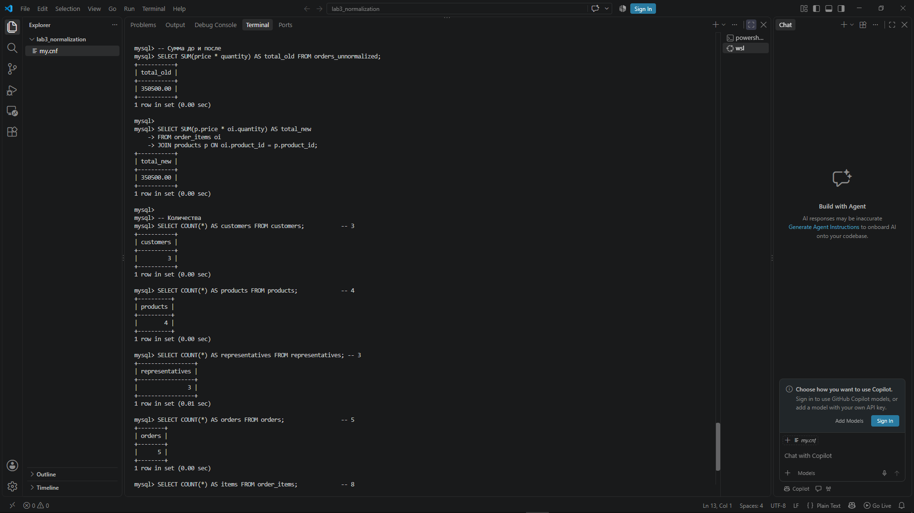
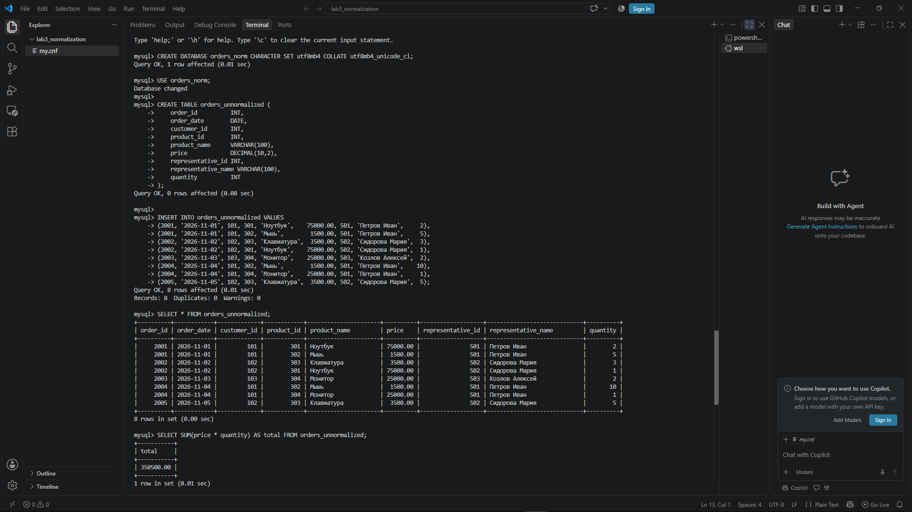
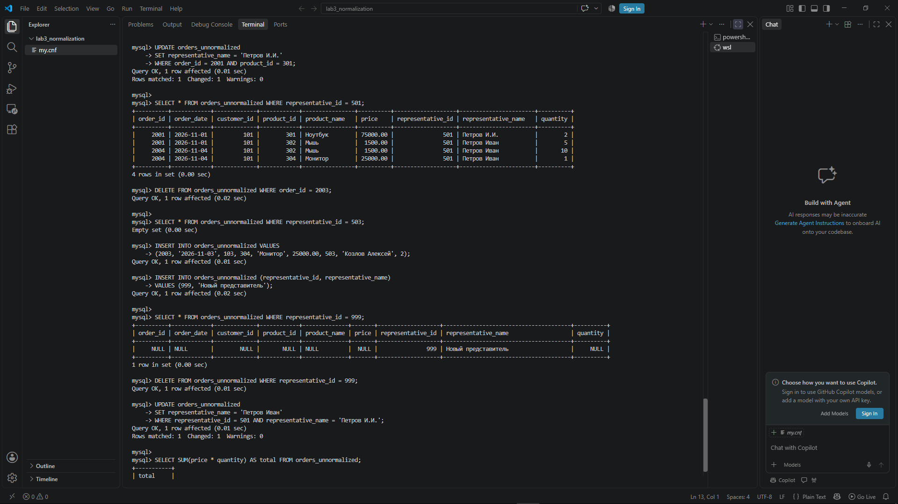
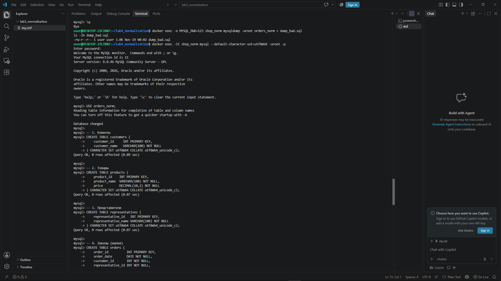
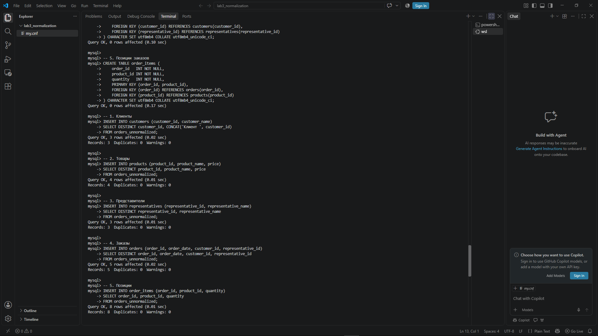

# 🗄️ Лабораторная работа №4: Нормализация данных в БД (WSL)

Нормализация таблицы заказов до 3NF в среде WSL (Ubuntu) с Docker и MySQL 8.0.

---

## 👨‍🎓 Информация о студенте

| Поле | Значение |
|------|----------|
| **ФИО** | Котохин Артём Ильич |
| **Курс** | 2 |
| **Специальность** | 09.02.07 «Информационные системы и программирование» |
| **Дата выполнения** | 19 ноября 2026 г. |
| **Среда выполнения** | WSL (Ubuntu) + VS Code + Docker |

---

## 🎯 Цель работы

Изучить нормализацию реляционной БД до 3NF на примере таблицы заказов, устранить аномалии обновления, удаления и вставки, соблюсти условие: один код заказа соответствует только одному представителю.

---

## 📋 Задачи

1. Создать БД `orders_norm` и таблицу `orders_unnormalized`
2. Продемонстрировать три аномалии
3. Привести данные к 3NF — 5 таблиц (`customers`, `products`, `representatives`, `orders`, `order_items`)
4. Перенести данные через `INSERT ... SELECT DISTINCT`
5. Проверить целостность (сумма 350 500.00)
6. Сделать дампы до и после нормализации
7. Настроить логирование и экспортировать отфильтрованный лог

---

## 🛠️ Технологии

- **ОС:** Windows 11 + WSL (Ubuntu)
- **СУБД:** MySQL 8.0 (Docker)
- **IDE:** Visual Studio Code (Remote-WSL)
- **Терминал:** Bash (WSL)
- **Контроль версий:** Git + GitHub

---

## 📁 Структура репозитория

```
lab4_normalization/
├── README.md
├── my.cnf
├── dump_bad.sql
├── norm_dump.sql
├── general.log
└── my_actions.log
```

---

## 🚀 Запуск

```bash
mkdir ~/lab4_normalization && cd ~/lab4_normalization
# Создать my.cnf, затем:
docker run --name shop_norm \
  -e MYSQL_ROOT_PASSWORD=123 \
  -e LANG=C.UTF-8 \
  -e MYSQL_INITDB_SKIP_TZINFO=1 \
  -v mysql_data:/var/lib/mysql \
  -v $(pwd)/my.cnf:/etc/mysql/conf.d/my.cnf \
  -d mysql:8.0
```

---

## 📊 Результаты

| Метрика | Значение |
|---------|----------|
| Клиентов | 3 ✅ |
| Товаров | 4 ✅ |
| Представителей | 3 ✅ |
| Заказов | 5 ✅ |
| Позиций | 8 ✅ |
| Общая сумма заказов | 350 500.00 ✅ |
| Сумма продаж Петрова (id=501) | 197 500.00 ✅ |

---

## 🧠 Выводы

1. **3NF устраняет аномалии** — имя представителя хранится в одном месте
2. **Условие выполнено** — один код заказа соответствует только одному представителю
3. **Данные не теряются** — проверка суммы подтверждает целостность
4. **WSL удобнее Git Bash** — grep работает нативно, нет проблем с кодировкой
5. **Логирование через `general_log`** + фильтрация через `grep` — простой способ аудита

---

> **Котохин А.И.**, 2 курс, 09.02.07







